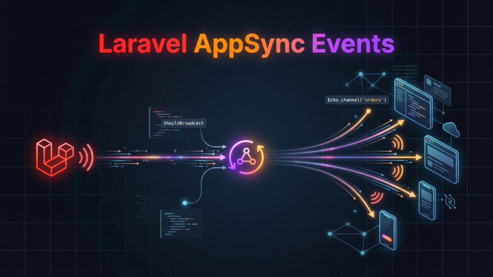
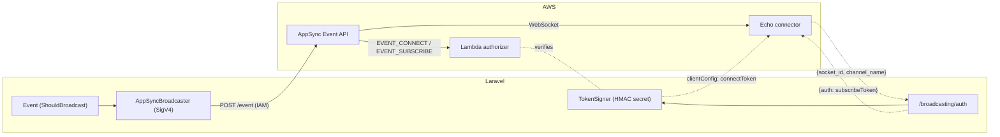

Broadcast Laravel events over **AWS AppSync Event APIs** — managed, serverless WebSocket fan-out — with a matching [Laravel Echo](https://github.com/laravel/echo) 2 connector on the client. The package publishes events with SigV4-signed HTTP calls, authorizes connections and subscriptions through an AppSync Lambda authorizer that verifies HMAC tokens issued by your app, and ships the Echo connector as `@hds-solutions/laravel-echo-appsync`.

[](https://github.com/hschimpf/laravel-appsync-events/actions/workflows/ci.yml)
[](https://packagist.org/packages/hds-solutions/laravel-appsync-events)
[](https://www.npmjs.com/package/@hds-solutions/laravel-echo-appsync)
[](LICENSE)

## What it is

AWS AppSync [Event APIs](https://docs.aws.amazon.com/appsync/latest/eventapi/event-api-concepts.html) give you a managed WebSocket endpoint: AWS holds the sockets, routes published events to channel subscribers, and scales the fan-out for you. This package plugs that into Laravel's broadcasting layer — `ShouldBroadcast` events, `routes/channels.php` authorization, `Broadcast::channel()` — so you get realtime delivery **without running Reverb, Pusher, or any WebSocket server of your own**.

Use it when you want Laravel-native broadcasting but can't (or don't want to) operate a WebSocket fleet. AppSync Events is billed per published event and per connection time — check the [AWS pricing page](https://aws.amazon.com/appsync/pricing/) for current numbers.

### How it differs

The community package [`7amoood/laravel-appsync-broadcaster`](https://github.com/7amoood/laravel-appsync-broadcaster) solves the same problem with a different shape: Cognito OAuth for auth, a Redis-backed worker, and a Pawl WebSocket client that keeps a persistent publish connection; it ships no Echo connector. This package instead:

- publishes over **HTTP with SigV4/IAM** — a stateless `POST /event`, no persistent publisher socket, no worker;
- authorizes connections/subscriptions with a **Lambda authorizer** that verifies HMAC tokens your app issues (no Cognito, no Redis);
- ships an **Echo 2 connector** so the frontend stays `echo.private('orders.1').listen(...)`.

## Architecture



1. A `ShouldBroadcast` event fires; `AppSyncBroadcaster` SigV4-signs a `POST /event` to the Event API's HTTP endpoint with IAM credentials.
2. AppSync delivers the event to every client subscribed to the mapped channel path (`/orders/private/1` for `private-orders.1`).
3. The browser connects with a **connect token** (from `AppSyncEvents::clientConfig()`) and asks your app for a per-channel **subscribe token** via `POST /broadcasting/auth` — the standard Echo channel-auth flow.
4. AppSync calls your **Lambda authorizer** for `EVENT_CONNECT` and `EVENT_SUBSCRIBE`; `AppSyncAuthorizer` verifies the token's HMAC signature, purpose and channel.
5. `EVENT_PUBLISH` is always denied — clients can never publish; publishing is a server-side, IAM-only operation.

## Requirements

| Component | Version |
| --- | --- |
| PHP | `^8.2` |
| Laravel / Illuminate | `^11.0 \| ^12.0 \| ^13.0` |
| laravel-echo (peer) | `^2.0` |
| Node.js (build & test the `js/` package) | `>= 22` — the published package runs in browsers |
| AWS | An AppSync **Event API** (not a GraphQL API) — see [AWS setup](docs/aws-setup.md) |

## Installation

```bash
composer require hds-solutions/laravel-appsync-events
php artisan appsync-events:install      # publishes config, adds .env placeholders
php artisan appsync-events:secret       # generates APPSYNC_CHANNEL_SIGNING_SECRET

npm install laravel-echo @hds-solutions/laravel-echo-appsync
```

Then set the environment values (the install command adds the placeholders to `.env.example`):

```dotenv
BROADCAST_CONNECTION=appsync

APPSYNC_HTTP_ENDPOINT=https://<id>.appsync-api.<region>.amazonaws.com/event
APPSYNC_REALTIME_ENDPOINT=wss://<id>.appsync-realtime-api.<region>.amazonaws.com/event/realtime
APPSYNC_CHANNEL_SIGNING_SECRET=<64 hex chars from appsync-events:secret>
```

`appsync-events:secret --show` prints a secret without touching `.env`; `--force` overwrites an existing one. The **same secret** must be deployed to the Lambda authorizer — it is never sent to AWS or to clients.

## Five-minute quick start

**1. Authorize the channel** — `routes/channels.php`:

```php
use App\Models\User;
use Illuminate\Support\Facades\Broadcast;

Broadcast::channel('orders.{id}', function (User $user, int $id) {
    return $user->can('view-order', $id);
});
```

**2. Broadcast an event:**

```php
use Illuminate\Broadcasting\PrivateChannel;
use Illuminate\Contracts\Broadcasting\ShouldBroadcast;

class OrderShipped implements ShouldBroadcast
{
    public function __construct(public readonly int $orderId) {}

    public function broadcastOn(): array
    {
        return [new PrivateChannel('orders.'.$this->orderId)];
    }
}
```

**3. Listen in the frontend:**

```ts
import Echo from 'laravel-echo';
import { appSyncEchoOptions } from '@hds-solutions/laravel-echo-appsync';

const echo = new Echo(appSyncEchoOptions({
    wsEndpoint: 'wss://<id>.appsync-realtime-api.<region>.amazonaws.com/event/realtime',
    connectToken: () => fetchConnectToken(), // re-evaluated on every (re)connect
}));

echo.private('orders.1').listen('.OrderShipped', (e: unknown) => {
    console.log(e);
});
```

The Laravel channel name `private-orders.1` (Echo adds `private-`) maps to the AppSync channel path `/orders/private/1` — so an `orders` channel namespace must exist on the Event API.

## AWS setup

Before the driver works, AWS needs:

- an **Event API** with auth providers `AWS_LAMBDA` + `AWS_IAM` (plus `API_KEY` only if you use public channels), connection mode `AWS_LAMBDA`, default publish mode `AWS_IAM`, default subscribe mode `AWS_LAMBDA`;
- **channel namespaces** matching your channel-name prefixes (e.g. `orders`, `default`);
- a **Lambda authorizer** holding the same `APPSYNC_CHANNEL_SIGNING_SECRET`, with a `lambda:InvokeFunction` resource policy for `appsync.amazonaws.com` scoped to the API ARN;
- an **IAM policy** granting your app's role `appsync:EventPublish` on `arn:aws:appsync:<region>:<account>:apis/<api-id>/channelNamespace/<namespace>`.

Full walkthrough plus CloudFormation, Serverless Framework, Terraform and CDK examples: **[docs/aws-setup.md](docs/aws-setup.md)**.

### Authorization types

AppSync Events offers five [authorization types](https://docs.aws.amazon.com/appsync/latest/eventapi/configure-event-api-auth.html); this package uses three of them:

| Type | Used for | Supported |
| --- | --- | --- |
| `AWS_IAM` | Your app **publishing** events (SigV4 `POST /event`) | Yes — required |
| `AWS_LAMBDA` | Clients **connecting and subscribing** to private channels, with Laravel's `Broadcast::channel()` callbacks deciding access | Yes — required for private channels |
| `API_KEY` | Anonymous, read-only **public channels** | Yes — optional |
| `OPENID_CONNECT` | Clients authenticating with an OIDC provider | No |
| `AMAZON_COGNITO_USER_POOLS` | Clients authenticating with Cognito | No |

The package is PHP-strict: your Laravel users and `routes/channels.php` stay the source of truth, so Cognito and OIDC client authentication are out of scope. AppSync lets you set the authorization mode per namespace, so public channels (`API_KEY`) and private channels (`AWS_LAMBDA`) can live side by side on the same Event API.

Your Laravel app can run anywhere — Laravel Vapor, Docker, ECS, a VM. It publishes with the AWS SDK's default credential chain (environment variables, web identity, ECS task role, EC2 instance profile), so on a role-based platform you don't configure any keys; the role only needs `appsync:EventPublish`. It also serves `/broadcasting/auth`, which needs no AWS access.

- **Laravel Vapor** — your app's Lambda runs under Vapor's `laravel-vapor-role`, whose credentials reach the app through the reserved `AWS_*` variables. Add `appsync:EventPublish` to that role. Vapor manages the role itself, so [disable "Receive updates" on it](https://laravel.com/blog/vapor-customize-default-role) first or your change may be overwritten. Don't set `AWS_*` keys in the environment (Vapor reserves them); set `APPSYNC_REGION` if you don't want to rely on the injected `AWS_DEFAULT_REGION`.
- **Docker / ECS** — attach the permission to the task role; no keys needed.

The one piece that must run on Lambda is the authorizer below, because AppSync invokes it directly. Vapor deploys your Laravel app's functions, so deploy the authorizer separately (Serverless Framework with Bref, CloudFormation, Terraform or CDK — see [docs/aws-setup.md](docs/aws-setup.md)); it only needs the same `APPSYNC_CHANNEL_SIGNING_SECRET`.

## The Lambda authorizer

`AppSyncAuthorizer::authorize(array $event): array` (`HDSSolutions\Laravel\AppSyncEvents\Lambda`) verifies the authorizer event and returns the AppSync contract `{isAuthorized, ttlOverride, handlerContext?}`:

- `EVENT_CONNECT` → verified, unexpired token with `purpose: connect`.
- `EVENT_SUBSCRIBE` → verified, unexpired `purpose: subscribe` token whose `channel` claim equals `requestContext.channel`.
- `EVENT_PUBLISH` (and anything else) → always denied.

The class is framework-agnostic — constructor-injected secret, no container access — so it runs under any PHP Lambda runtime.

### Plain PHP handler

```php
<?php

use HDSSolutions\Laravel\AppSyncEvents\Lambda\AppSyncAuthorizer;

return function (array $event): array {
    return (new AppSyncAuthorizer(
        $_ENV['APPSYNC_CHANNEL_SIGNING_SECRET'] ?? '',
        (int) ($_ENV['APPSYNC_AUTHORIZER_CACHE_TTL'] ?? 300),
    ))->authorize($event);
};
```

### With Bref

[Bref](https://bref.sh) is one way to run PHP on Lambda — it is **not** a dependency of this package. With Bref 3, an event handler implements `Bref\Event\Handler` (see [Bref function handlers](https://bref.sh/docs/function/handlers)):

```php
<?php

namespace App\Lambda;

use Bref\Context\Context;
use Bref\Event\Handler;
use HDSSolutions\Laravel\AppSyncEvents\Lambda\AppSyncAuthorizer;

final class AppsyncEventsAuthorizer implements Handler
{
    public function handle($event, Context $context): array
    {
        // If the function boots your Laravel app (e.g. bref/laravel-bridge),
        // resolve from the container instead: app(AppSyncAuthorizer::class)
        return (new AppSyncAuthorizer(
            $_ENV['APPSYNC_CHANNEL_SIGNING_SECRET'] ?? '',
        ))->authorize($event);
    }
}
```

```yaml
functions:
    authorizer:
        handler: App\Lambda\AppsyncEventsAuthorizer
        runtime: php-82
        environment:
            APPSYNC_CHANNEL_SIGNING_SECRET: ${ssm:/my-app/appsync-signing-secret}
            # The authorizer must never broadcast itself — see warning below.
            BROADCAST_CONNECTION: log
            APPSYNC_HTTP_ENDPOINT: ''
            APPSYNC_REALTIME_ENDPOINT: ''
```

> **Warning — no self-invocation.** The authorizer Lambda must never broadcast: if it boots your application, force `BROADCAST_CONNECTION=log` (or `null`) and leave the AppSync endpoint env vars empty. A function that publishes to the API it authorizes can invoke itself recursively.

## Backend configuration

`config/appsync-events.php` (publish with `php artisan vendor:publish --tag=appsync-events-config`):

| Key | Env var | Default | Description |
| --- | --- | --- | --- |
| `http_endpoint` | `APPSYNC_HTTP_ENDPOINT` | — | Event API HTTP endpoint the broadcaster POSTs to. **Required.** |
| `realtime_endpoint` | `APPSYNC_REALTIME_ENDPOINT` | — | WebSocket endpoint handed to the JS connector. **Required for `clientConfig()`.** |
| `signing_secret` | `APPSYNC_CHANNEL_SIGNING_SECRET` | — | HMAC secret shared with the Lambda authorizer. **Required.** |
| `region` | `APPSYNC_REGION` → `AWS_DEFAULT_REGION` | `us-east-1` | SigV4 region fallback when it can't be parsed from `http_endpoint`. |
| `default_namespace` | `APPSYNC_DEFAULT_NAMESPACE` | `default` | Namespace for channel names without a dot. |
| `tokens.connect_ttl` | — | `43200` | Connect token lifetime, seconds (12 h). |
| `tokens.subscribe_ttl` | — | `3600` | Subscribe token lifetime, seconds (1 h). |
| `authorizer.cache_ttl` | — | `300` | `ttlOverride` the authorizer returns for authorized calls. |
| `http.timeout` | — | `2.0` | Publish request timeout, seconds. |
| `http.connect_timeout` | — | `1.0` | Publish connect timeout, seconds. |
| `uid_resolver` | — | `null` | Invokable class-string to derive the `uid` token claim; `null` = `getAuthIdentifier()`. |
| `client.auth_endpoint` | — | `/broadcasting/auth` | Where the connector requests channel authorization. |
| `client.inactivity_timeout` | `APPSYNC_INACTIVITY_TIMEOUT` | `10` | Seconds; shipped in `clientConfig()` for your client code to consume (see [Vue composable](#visibility-aware-echo-vue-3)). |
| `routes.auth.enabled` | — | `true` | Registers `/broadcasting/auth` via `Broadcast::routes()` (never shadows your own route). |
| `routes.auth.middleware` | — | `['web']` | Middleware on the auth endpoint. |
| `routes.client_config.enabled` | — | `false` | Opt-in JSON endpoint serving the connector config. |
| `routes.client_config.uri` | — | `broadcasting/appsync` | URI of the client-config endpoint. |
| `routes.client_config.middleware` | — | `['web', 'auth']` | Middleware on the client-config endpoint. |

### Per-connection overrides

The `appsync` broadcasting connection merges over the package config, so `config/broadcasting.php` may override `http_endpoint`, `signing_secret`, `region`, `default_namespace` and `http.*` per connection:

```php
'connections' => [
    'appsync' => [
        'driver' => 'appsync',
        // 'http_endpoint' => env('APPSYNC_HTTP_ENDPOINT'), // optional override
    ],
],
```

### The `AppSyncEvents` facade

| Method | Returns |
| --- | --- |
| `AppSyncEvents::clientConfig(?Authenticatable $user = null)` | Connector options `{wsEndpoint, httpHost, connectToken, authEndpoint, defaultNamespace, inactivityTimeout}` — `null` for guests. The `connectToken` is a static string minted once. |
| `AppSyncEvents::uid($user)` | The `uid` claim for tokens: runtime closure → `uid_resolver` class → `getAuthIdentifier()`. |
| `AppSyncEvents::resolveUidUsing(Closure)` | Set the uid strategy at runtime (config is not a place for closures). |
| `AppSyncEvents::signer()` | The `TokenSigner` bound to `signing_secret` (`connectToken()`, `subscribeToken()`). |
| `AppSyncEvents::httpHost($endpoint)` | The `host[:port]` authority the handshake authorizes. |

## Frontend usage

### Inertia.js

Share the client config as a prop — `App/Http/Middleware/HandleInertiaRequests.php`:

```php
public function share(Request $request): array
{
    return [
        ...parent::share($request),
        'appSync' => AppSyncEvents::clientConfig($request->user()),
    ];
}
```

```ts
const echo = new Echo(appSyncEchoOptions(props.appSync));
```

`props.appSync` is already the exact `AppSyncConnectorOptions` shape — spread or pass directly. Its `connectToken` is a static string; if your sessions outlive `tokens.connect_ttl`, wrap it in a re-fetching function (see the SPA variant below).

### Decoupled SPA

Enable the client-config route and protect it with your API middleware:

```php
'routes' => [
    'client_config' => [
        'enabled' => true,
        'middleware' => ['auth:sanctum'],
    ],
],
```

```ts
const config = await fetch('/broadcasting/appsync', { credentials: 'include' })
    .then((r) => r.json());

const echo = new Echo(appSyncEchoOptions({
    ...config,
    credentials: 'include',          // cookies on the channel-auth POST too
    connectToken: () => fetch('/broadcasting/appsync', { credentials: 'include' })
        .then((r) => r.json())
        .then((c) => c.connectToken), // fresh token on every (re)connect
}));
```

Cross-origin apps need `Access-Control-Allow-Credentials` on both endpoints — configure Laravel's `config/cors.php` accordingly.

### CSRF headers

For `web`-guarded auth endpoints, send the CSRF token on the channel-auth POST:

```ts
appSyncEchoOptions({
    // ...
    auth: {
        headers: { 'X-CSRF-TOKEN': csrfToken },
    },
})
```

Or use `bearerToken` for Sanctum token auth instead.

### Visibility-aware Echo (Vue 3)

`clientConfig().inactivityTimeout` is a hint your code consumes — the connector itself doesn't time out idle tabs. This composable disconnects a hidden tab after `inactivityTimeout` seconds and reconnects on return:

```ts
import Echo from 'laravel-echo';
import { appSyncEchoOptions } from '@hds-solutions/laravel-echo-appsync';
import type { AppSyncConnectorOptions } from '@hds-solutions/laravel-echo-appsync';
import { onBeforeUnmount, onMounted, readonly, ref } from 'vue';

export function useAppSyncEcho(options: AppSyncConnectorOptions, inactivityTimeout = 10) {
    const echo = new Echo(appSyncEchoOptions(options));
    const connected = ref(false);
    let timer: ReturnType<typeof setTimeout> | undefined;

    const connect = () => {
        clearTimeout(timer);
        echo.connector.connect();
        connected.value = true;
    };

    const disconnect = () => {
        clearTimeout(timer);
        echo.disconnect();
        connected.value = false;
    };

    const onVisibilityChange = () => {
        if (document.visibilityState === 'visible') connect();
        else timer = setTimeout(disconnect, inactivityTimeout * 1000);
    };

    onMounted(() => {
        document.addEventListener('visibilitychange', onVisibilityChange);
        connect();
    });

    onBeforeUnmount(() => {
        document.removeEventListener('visibilitychange', onVisibilityChange);
        disconnect();
    });

    return { echo, connected: readonly(connected), connect, disconnect };
}
```

### Public channels

For anonymous, read-only channels, add `API_KEY` to the Event API's connection and subscribe auth modes and pass the key to the connector — no connect token or auth endpoint round-trip:

```ts
new Echo(appSyncEchoOptions({
    wsEndpoint: 'wss://<id>.appsync-realtime-api.<region>.amazonaws.com/event/realtime',
    publicApiKey: 'da2-xxxxxxxxxxxxxxxxxxxxxxxxxx',
}));
```

## Broadcasting to others

`broadcast(new OrderShipped($order))->toOthers()` is supported: the sender's socket id (the `X-Socket-ID` header Echo attaches to the request that triggered the broadcast) is lifted out of the event data into a `socket` field on the published event envelope, and the Echo connector drops any event whose envelope socket matches its own `socketId()`.

This is client-side filtering — AppSync has no server-side sender exclusion, so other connectors or raw subscribers still receive the event.

## Channel names and AppSync channel paths

Laravel channel names map to AppSync channel paths `/{namespace}/{type}/{segment}` — the mapping is identical in PHP (`ChannelPath`) and TS (`toAppSyncChannel`), verified against a shared fixture:

| Laravel channel name | AppSync channel path |
| --- | --- |
| `orders` | `/default/public/orders` |
| `orders.1` | `/orders/public/1` |
| `orders.1.items` | `/orders/public/1-items` |
| `private-orders.1` | `/orders/private/1` |
| `private-private.abc` | `/private/private/abc` |
| `private-orders.1.items` | `/orders/private/1-items` |
| `private-encrypted-orders.9` | `/orders/private/9` |
| `private-solo` | `/default/private/solo` |
| `presence-room.5` | `/room/presence/5` |
| `privateer.x` | `/privateer/public/x` |

Rules:

- Channel-type prefixes `private-`, `private-encrypted-` (encrypted maps to `private`) and `presence-` select the `{type}` segment; everything else is `public`. Prefixes are exact — `privateer.x` is public.
- The first dot-segment is the **namespace**; remaining dots become dashes. Dotless names use `default_namespace` (`default` unless configured).
- **Create one channel namespace per prefix you use** — subscribing or publishing to a missing namespace fails.
- Every segment must be alphanumeric at both ends with `[A-Za-z0-9_-]` inside (AppSync namespaces are additionally capped at 50 chars). Invalid names throw `InvalidArgumentException` (PHP) / `InvalidChannelNameError` (JS) instead of hitting the API.

## Security model

- **Token wire format** — `base64url(json(claims)) + '.' + hex(hmac_sha256(payload, secret))`. Claims: `purpose` (`connect`/`subscribe`), `uid`, `exp` (unix), and `channel` (the AppSync path) on subscribe tokens. The secret is shared only between your app and the authorizer — never sent to AWS or clients.
- **TTLs** — `tokens.connect_ttl` (default 12 h) and `tokens.subscribe_ttl` (1 h). `authorizer.cache_ttl` is the `ttlOverride` returned on authorized calls — how long AppSync may cache the decision.
- **Publish is never client-authorized** — `EVENT_PUBLISH` is denied unconditionally; publishing requires IAM `appsync:EventPublish`.
- **Secret hygiene** — keep `APPSYNC_CHANNEL_SIGNING_SECRET` out of VCS (use SSM/Secrets Manager for the Lambda side). To rotate: deploy the new secret to the app and the authorizer together — outstanding tokens become invalid, so clients reconnect and re-authorize.
- **Least privilege** — scope `appsync:EventPublish` to the namespaces you use, and the authorizer's `SourceArn` to the API.
- **Testing** — the [AWS emulator](tests/emulator/README.md) used by the test suite does **not** verify SigV4 signatures, does not invoke Lambda authorizers, and does not validate token contents; those paths are covered by unit tests. Do not use the emulator for security testing.

## Local development

Keep `BROADCAST_CONNECTION=reverb` (or `log`) locally and `appsync` in production — broadcasting is driver-agnostic, so nothing else changes. For AppSync-specific behavior, the repo runs against the [AWS emulator](tests/emulator/README.md): `tests/emulator/start.sh`, then `composer test:emulator` / `npm --prefix js run test:emulator`.

## Testing and contributing

```bash
composer test          # Pest (unit + feature)
composer lint          # Pint
composer analyse       # PHPStan
npm --prefix js test   # Vitest
```

Emulator tests, fixture conventions and the PR checklist live in [CONTRIBUTING.md](CONTRIBUTING.md); security reports go through [SECURITY.md](SECURITY.md).

## Limitations

- **No presence channels** — `echo.join()` / `presenceChannel()` throws; presence metadata has no AppSync Events equivalent.
- **No client events / whispers** — clients cannot publish by design.
- **One Echo connector instance per socket** — the connector multiplexes channels over a single AppSync WebSocket; concurrent reconnects reuse the latest connect generation only.
- **Emulator caveats** — see [tests/emulator/README.md](tests/emulator/README.md).

## Versioning and license

Both packages follow SemVer and release in lockstep (`0.x` while the API surface stabilizes). MIT — see [LICENSE](LICENSE). Built by [Hermann D. Schimpf](https://hds-solutions.net).
